<picture>
  <source media="(prefers-color-scheme: dark)" srcset="assets/banner.svg">
  <source media="(prefers-color-scheme: light)" srcset="assets/banner_light.svg">
  
</picture>

I build models from the math up and ship them into production: deep learning, LLM systems, and the MLOps around them. Evaluation is the part I care about most; it's where the real work happens.

<picture>
  <source media="(prefers-color-scheme: dark)" srcset="assets/divider.svg">
  <source media="(prefers-color-scheme: light)" srcset="assets/divider_light.svg">
  
</picture>

<picture>
  <source media="(prefers-color-scheme: dark)" srcset="assets/stats.svg">
  <source media="(prefers-color-scheme: light)" srcset="assets/stats_light.svg">
  
</picture>

## 🎮 Quest Log

<picture>
  <source media="(prefers-color-scheme: dark)" srcset="assets/quests.svg">
  <source media="(prefers-color-scheme: light)" srcset="assets/quests_light.svg">
  
</picture>

## 🔩 Featured Build: BareMetalML

*An ML library written from scratch with only NumPy. No scikit-learn, no shortcuts.*

- **Linear Regression:** the normal equation, batch and SGD, Ridge (L2) regularization
- **Logistic Regression:** sigmoid, binary cross-entropy, one-vs-rest multiclass
- **Decision Trees:** Gini and entropy splits, decision boundary visualization
- **Random Forest:** bootstrap aggregation, in progress
- **Tooling:** my own train/test split, scalers, and MSE/R² metrics

`Python` · `NumPy` · `Pandas` · `Matplotlib`

<picture>
  <source media="(prefers-color-scheme: dark)" srcset="assets/divider.svg">
  <source media="(prefers-color-scheme: light)" srcset="assets/divider_light.svg">
  
</picture>

## 🏆 Achievements

<picture>
  <source media="(prefers-color-scheme: dark)" srcset="assets/achievements.svg">
  <source media="(prefers-color-scheme: light)" srcset="assets/achievements_light.svg">
  
</picture>

| Competition | Result | Field |
|:---|:---:|:---|
| Academic Success Classification | **47 / 2,684** · top 2% | Tabular classification |
| Irrigation Need Prediction | **86 / 4,315** · top 2% | Tabular classification |
| Calorie Expenditure Prediction | **150 / 4,316** · top 4% | Tabular regression |

## ⚔️ Boss Battles

<picture>
  <source media="(prefers-color-scheme: dark)" srcset="assets/boss.svg">
  <source media="(prefers-color-scheme: light)" srcset="assets/boss_light.svg">
  
</picture>

[LLM 20 Questions](https://www.kaggle.com/competitions/llm-20-questions), a featured Kaggle competition with 832 teams. I built an LLM agent informed by published research on question-asking and information elimination.

---

## 🧪 Experience

**AI Engineer Intern · Arcitech AI** · `Jul – Dec 2025`
- Built a CNN speech-emotion model from scratch: ~88% accuracy across 7 classes, under 50 MB, edge-deployable
- Shipped a production FastAPI service that transcribes calls, runs NER and PII redaction, scores voice intensity, and computes 12 KPIs
- Benchmarked Whisper against AssemblyAI on noisy call audio and moved the pipeline to the winner

**AI Engineer Intern · Ebizon Cloud** · `Mar – May 2025`
- Built a RAG pipeline over Oracle Cloud documentation with FAISS retrieval and source-linked answers
- Benchmarked 5+ LLMs on an 80–100 question evaluation set (OpenRouter) and built a hallucination-mitigation framework: confidence scoring, citation verification, answer cross-checking

## 🛠️ Inventory

<picture>
  <source media="(prefers-color-scheme: dark)" srcset="assets/loadout.svg">
  <source media="(prefers-color-scheme: light)" srcset="assets/loadout_light.svg">
  
</picture>

<picture>
  <source media="(prefers-color-scheme: dark)" srcset="assets/divider.svg">
  <source media="(prefers-color-scheme: light)" srcset="assets/divider_light.svg">
  
</picture>

## 📊 Stats

  
  &nbsp;
  

  

## 📬 Continue?

Open to machine and deep learning roles. Email me, or find me on [LinkedIn](https://linkedin.com/in/bhaskar9221) and [Kaggle](https://kaggle.com/bhaskarkumar11).

 

`▓▒░ PRESS START ░▒▓`

<i>Derive it. Train it. Ship it.</i>

