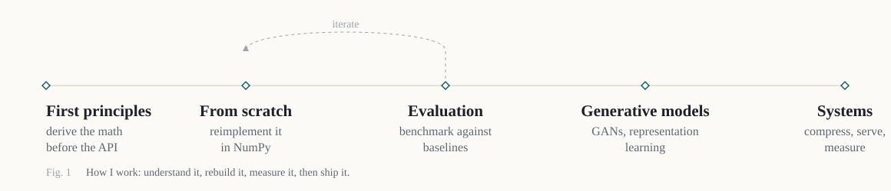

# Bhaskar Mondal

**Machine & Deep Learning Engineer**

[Email](mailto:bhaskarmondal7221@gmail.com) · [LinkedIn](https://linkedin.com/in/bhaskar9221) · [Kaggle](https://kaggle.com/bhaskarkumar11) · Open to ML research, research engineering, and ML engineering roles

<!--
  When your site or Google Scholar profile is live, add them here:
  [Website](https://your-site) · [Google Scholar](https://scholar.google.com/...)
-->

---

### Research statement

I am an engineer by training and a scientist at heart. I care less about which library solves a problem and more about whether I can derive the solution, reimplement it, and show where it breaks.

My work follows one loop: understand the math, rebuild the method from scratch, measure it against a reference, and only then trust the result. I am drawn to deep learning, generative models, and the unglamorous part of research that makes results mean something: evaluation.

<picture>
  <source media="(prefers-color-scheme: dark)" srcset="assets/research-map-dark.svg">
  
</picture>

### Research interests

Deep learning and representation learning · generative models · optimization from first principles · evaluation and benchmarking · efficient inference

---

### My work

**BareMetalML** · Python, NumPy · [repository](https://github.com/bhaskar9221/BareMetalML)
*Question:* how much does building an algorithm yourself actually teach you about it?
*Method:* implemented eight algorithms from scratch: linear and logistic regression, decision trees, Random Forest, KNN, Naive Bayes, K-Means, and PCA. Scikit-learn appears only as a verification oracle and baseline.
*Result:* every implementation matches sklearn within 1e-10 on the same data. A head-to-head notebook trains all classifiers on one split, where the decision tree's 100% train accuracy next to 93% test accuracy shows overfitting directly in the decision boundary.

**Speech emotion recognition** · PyTorch · Arcitech AI
*Question:* can a small model generalize across recording conditions and speakers?
*Method:* trained a CNN from scratch on RAVDESS, TESS, CREMA-D, and SAVEE, under a 50 MB edge-deployment constraint.
*Result:* ~88% accuracy across 7 emotion classes, small enough to run at the edge.

**RAG with hallucination mitigation** · LangChain, FAISS · Ebizon Cloud
*Question:* how do you make a retrieval system's answers verifiable, not just fluent?
*Method:* built retrieval over Oracle Cloud documentation, then benchmarked five LLMs on an 80–100 question set.
*Result:* added confidence scoring, citation verification, and answer cross-checking, and selected models on measured grounding rather than impression.

**AnimeGAN** · PyTorch · *in progress*
*Question:* what does a generator actually learn about style, and what does it preserve from the input?
*Method:* building a GAN from scratch to control and inspect the components, rather than fine-tuning an existing one.

---

### Research questions

Four problems I keep returning to. They are open on purpose: each one is worth a paper, and each one has a concrete first experiment.

- **What does numerical agreement actually prove?** Two implementations can match to 1e-10 and still fail differently. BareMetalML verifies against sklearn on the same data; the harder question is whether they agree on *how* they fail: degenerate inputs, sparse regimes, and the boundaries where each implementation gives up.
- **When does an ensemble stop being worth it?** Random Forest almost always beats a single tree on clean data. The interesting regime is label noise: how much corruption before the ensemble's advantage disappears, and whether it degrades gracefully or collapses.
- **What does a generator actually encode?** Samples only show what a model produces, not what it represents. The question is whether AnimeGAN's latent space separates content from style, and how to probe that without relying on human eyes.
- **How small can an evaluation be and still be predictive?** Large benchmarks are expensive and often noisy. The question is which small, well-chosen sets preserve the rankings of the full benchmark, and where they mislead.

---

### Experience

**AI Engineer Intern** · Arcitech AI · `Jul – Dec 2025`
*Problem:* turn call recordings into measurable signals without giving up accuracy or deployability.
Worked across the pipeline: a from-scratch CNN for speech emotion, transcription with Whisper and then AssemblyAI after benchmarking on noisy audio, NER, PII redaction, emotion scoring, and a 12-KPI analytics engine, served through FastAPI for 100–150 calls per run.

**AI Engineer Intern** · Ebizon Cloud · `Mar – May 2025`
*Problem:* make a documentation assistant's answers verifiable.
Built the RAG pipeline and its evaluation, including the five-model benchmark and the hallucination-mitigation framework, refining chunking, retrieval, and prompting against the eval set rather than by intuition.

---

### Evaluation principles

1. Baseline before claim. A result means nothing without a reference point.
2. Measure where the model fails, not just how often it succeeds.
3. Report the constraint: size, latency, or cost, since it usually explains the tradeoff.
4. Prefer a small, well-designed eval you trust over a large, noisy one.

---

### Benchmarks

| Kaggle | Result | Field |
|:--|:--:|:--|
| Academic Success Classification | **47 / 2,684** · top 2% | Tabular classification |
| Irrigation Need Prediction | **86 / 4,315** · top 2% | Tabular classification |
| Calorie Expenditure Prediction | **150 / 4,316** · top 4% | Tabular regression |
| [LLM 20 Questions](https://www.kaggle.com/competitions/llm-20-questions) | 832 teams | LLM agent |

---

### Toolbox

Grouped by what the tool is for, not by logo. The work on this page was built with the first three groups; the rest is the surrounding research infrastructure I use or am building out.

**Core** — PyTorch · TensorFlow · Keras · NumPy · scikit-learn · XGBoost · LightGBM · CatBoost

**Generative and retrieval** — Hugging Face · LangChain · OpenAI · OpenRouter · FAISS · RAG pipelines · prompt engineering

**Experimentation and evaluation** — MLflow · Weights & Biases · TensorBoard · Optuna · custom eval sets

**Serving and inference** — FastAPI · vLLM · ONNX · quantization · batching · Streamlit · Gradio

**Scale and automation** — Ray · Airflow · Docker · Kubernetes · GCP · AWS

**Data work** — pandas · Polars · DuckDB · scikit-learn pipelines · feature engineering and validation

**Engineering hygiene** — Git · GitHub Actions · pytest · packaging · reproducible environments

**Languages** — Python (primary) · SQL (MySQL, PostgreSQL) · C/C++ (working knowledge)

---

[bhaskarmondal7221@gmail.com](mailto:bhaskarmondal7221@gmail.com) · Open to machine learning research and engineering work.
