<table>
<tr>
<td width="232" valign="top">
  <!-- Logo slot: replace the image below with your own logo (PNG or SVG) whenever you're ready. -->
  
</td>
<td valign="top">

# Bhaskar Mondal

**Machine & Deep Learning Engineer** · from-scratch implementations, LLM systems, and the evaluation that keeps them honest.

`●` Open to ML / DL roles · Currently building AnimeGAN from scratch

</td>
</tr>
</table>

I build models from the math up, then ship them. My work sits where research meets production: a CNN trained from scratch and deployed under 50 MB, a RAG system benchmarked against five LLMs, and a NumPy-only ML library that reimplements the algorithms I use.

## 🧩 Selected Work

<!--
  HOW TO EDIT: each project is one row. Change the name, the stack, the summary,
  and the links. Copy a row to add a project; delete a row to remove one.
-->

| Project | Stack | What it is |
|:--|:--|:--|
| **[BareMetalML](https://github.com/bhaskar9221/BareMetalML)** | Python · NumPy | Linear and logistic regression, decision trees, and Random Forest (in progress), written from scratch with no scikit-learn, plus my own scalers, splits, and metrics. |
| **CNN Speech Emotion Recognition** | PyTorch · Audio | Trained from scratch on RAVDESS, TESS, CREMA-D, and SAVEE: ~88% accuracy across 7 classes, under 50 MB, edge-deployable. |
| **RAG with Hallucination Checks** | LangChain · FAISS · OpenRouter | Retrieval over Oracle Cloud docs, benchmarked across 5+ LLMs on an 80–100 question set, with confidence scoring and citation verification. |
| **AnimeGAN** | PyTorch · GANs | A GAN built from scratch to generate anime-style images. *In progress.* |

## 🧪 Experience

**AI Engineer Intern · Arcitech AI** · `Jul – Dec 2025`
- Trained a speech-emotion CNN from scratch and shipped it as part of a production audio pipeline handling 100–150 calls per run.
- Built the FastAPI microservice behind it: transcription, NER, PII redaction, emotion scoring, and a 12-KPI analytics engine.
- Benchmarked Whisper against AssemblyAI on noisy call audio and moved the pipeline to the winner.

**AI Engineer Intern · Ebizon Cloud** · `Mar – May 2025`
- Built a RAG pipeline over Oracle Cloud documentation with FAISS retrieval and source-linked answers.
- Benchmarked 5+ LLMs against an evaluation set and built a hallucination-mitigation framework on top of the results.

## 🏅 Signals

| Kaggle | Result | Field |
|:--|:--:|:--|
| Academic Success Classification | **47 / 2,684** · top 2% | Tabular classification |
| Irrigation Need Prediction | **86 / 4,315** · top 2% | Tabular classification |
| Calorie Expenditure Prediction | **150 / 4,316** · top 4% | Tabular regression |
| [LLM 20 Questions](https://www.kaggle.com/competitions/llm-20-questions) | 832 teams | LLM agent |

I treat evaluation as the actual work: benchmarking models instead of trusting them, and measuring claims before putting them on a page.

## 🛠️ Stack

**Deep learning:** PyTorch · TensorFlow · Keras
**Classical ML:** scikit-learn · XGBoost · LightGBM · CatBoost
**GenAI:** LangChain · Hugging Face · OpenAI · OpenRouter · FAISS · RAG
**MLOps:** FastAPI · Docker · MLflow · GCP · AWS · Git · Streamlit · Gradio
**Languages:** Python · SQL (MySQL, PostgreSQL) · C/C++ (basic)

**Open to machine and deep learning roles.** Reach me at [bhaskarmondal7221@gmail.com](mailto:bhaskarmondal7221@gmail.com) or on [LinkedIn](https://linkedin.com/in/bhaskar9221).

